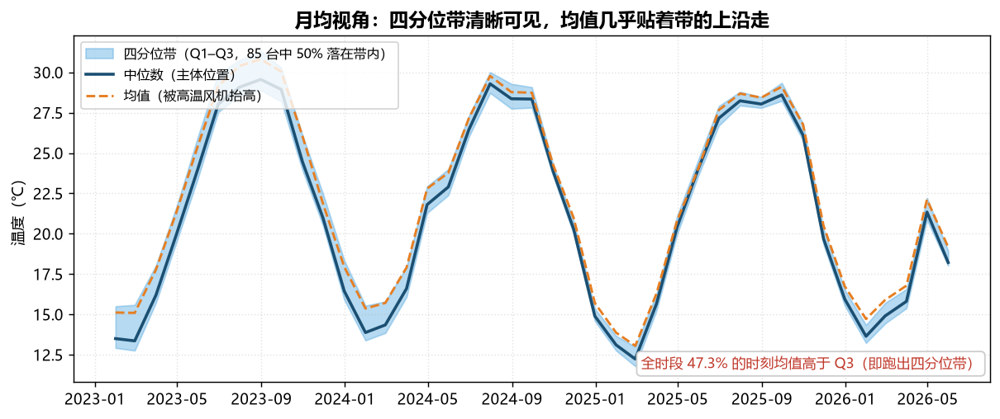
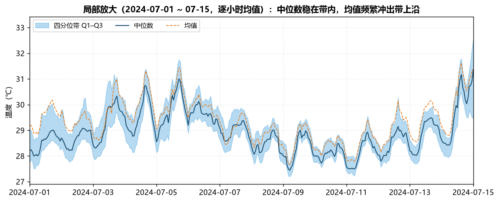
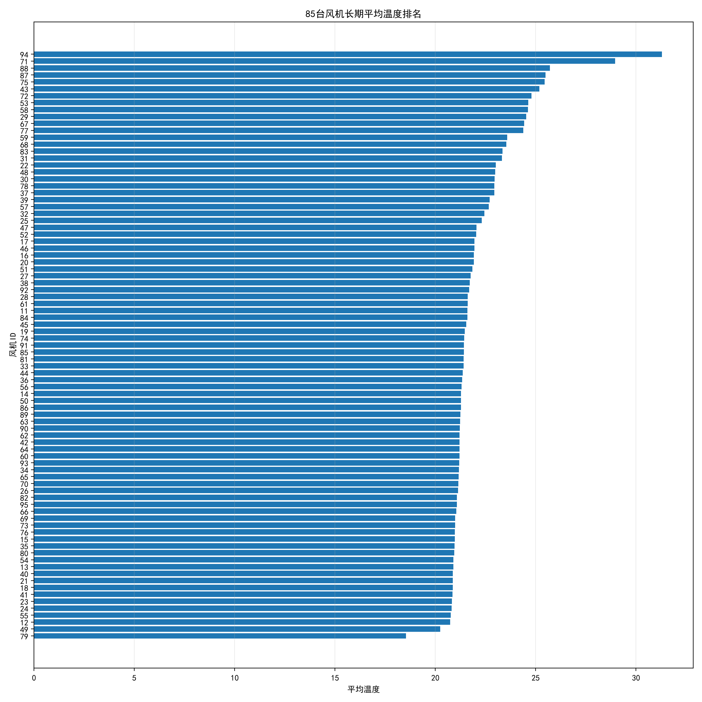
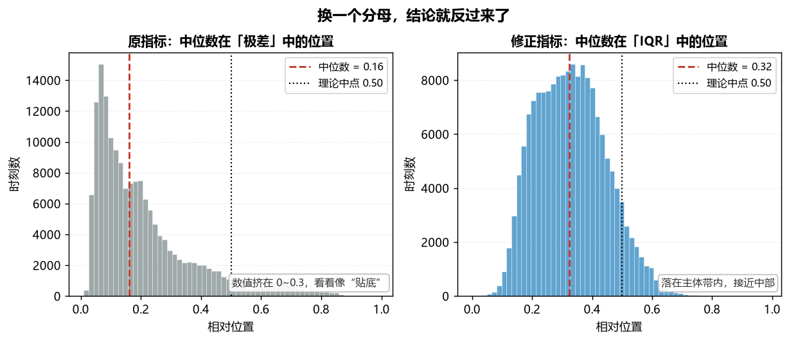
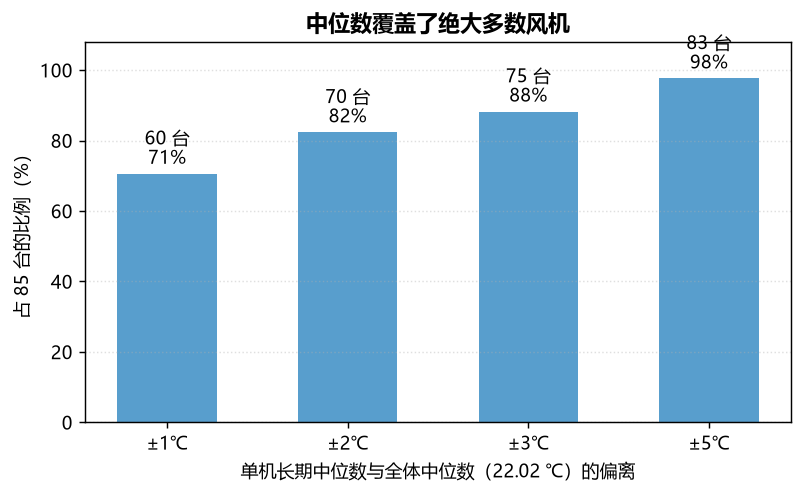
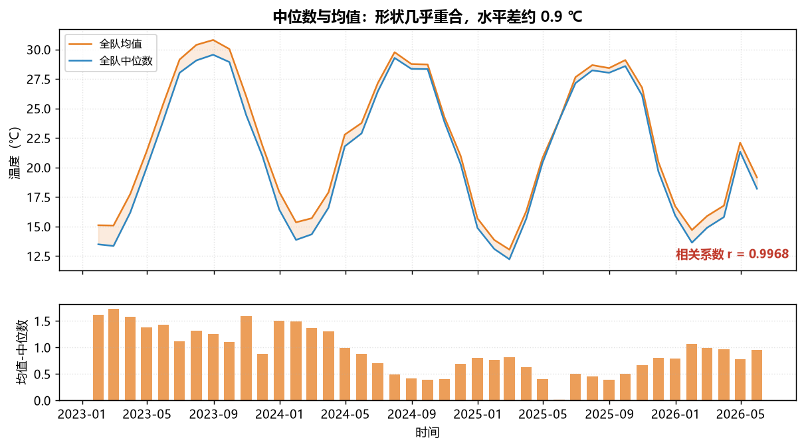

<!--
复制本文件来写新的任务汇报：
1. 文件名改成下一个编号，例如 04-renwu-huibao.Rmd
2. 改标题里的周次
3. 花括号里的 #report-1 也要改成不重复的，例如 #report-12
-->

# 会议总结（2026-11-16）

## 本周进度

### 内容一：



85 台风机温度四分位带与中位数的月均序列。四分位带（Q1–Q3）宽度中位 1.24 ℃，仅占全时段温度跨度（29.2 ℃）的 4.2%；中位数稳定位于带内，均值（虚线）贴近带上沿。




2024-07-01 至 07-15 逐小时放大。中位数始终落在四分位带内，均值频繁冲出带上沿，说明均值受少数高温风机影响，已偏离主体分布。

数据所用代码如下：

```python
import os
import numpy as np
import pandas as pd
import matplotlib
matplotlib.use("Agg")
import matplotlib.pyplot as plt
import matplotlib as mpl

try:
    import sys
    sys.stdout.reconfigure(encoding="utf-8", errors="replace")
except Exception:
    pass

mpl.rcParams["font.sans-serif"] = ["Microsoft YaHei", "SimHei", "Noto Sans CJK SC"]
mpl.rcParams["axes.unicode_minus"] = False
plt.rcParams["figure.dpi"] = 130
plt.rcParams["savefig.bbox"] = "tight"

DATA_DIR = os.environ.get("TEMPFIG_DATA", r"D:\桌面\温度中位数代表性检查")
OUT = os.path.join(os.environ.get("TEMPFIG_OUT", DATA_DIR), "改进")

BAND, MED, MEAN, RED = "#5DADE2", "#1B4F72", "#E67E22", "#C0392B"


def main():
    os.makedirs(OUT, exist_ok=True)
    t = pd.read_csv(os.path.join(DATA_DIR, "逐时刻温度统计.csv"), parse_dates=["时间"])
    t = t.set_index("时间")

    # ---------- 图A：月均，趋势与带宽同时可见 ----------
    m = t[["Q1", "中位数", "均值", "Q3"]].resample("ME").mean()
    fig, ax = plt.subplots(figsize=(11, 4.2))
    ax.fill_between(m.index, m["Q1"], m["Q3"], color=BAND, alpha=0.45,
                    label="四分位带（Q1–Q3，85 台中 50% 落在带内）")
    ax.plot(m.index, m["中位数"], color=MED, linewidth=2.0, label="中位数（主体位置）")
    ax.plot(m.index, m["均值"], color=MEAN, linewidth=1.6, linestyle="--", label="均值（被高温风机抬高）")
    ax.set_ylabel("温度（℃）")
    ax.set_title("月均视角：四分位带清晰可见，均值几乎贴着带的上沿走", fontsize=12.5, fontweight="bold")
    ax.legend(fontsize=9, loc="upper left")
    ax.grid(linestyle=":", alpha=0.35)
    ax.text(0.99, 0.04,
            "全时段 47.3% 的时刻均值高于 Q3（即跑出四分位带）",
            transform=ax.transAxes, ha="right", fontsize=9.5, color=RED,
            bbox=dict(boxstyle="round,pad=0.3", facecolor="white", edgecolor="#CCC"))
    fig.savefig(os.path.join(OUT, "图A_月均趋势与四分位带.png"))
    plt.close(fig)

    # ---------- 图B：局部放大，看清单个时刻 ----------
    w = t.loc["2024-07-01":"2024-07-15"].resample("1h").mean()
    fig, ax = plt.subplots(figsize=(11, 4.2))
    ax.fill_between(w.index, w["Q1"], w["Q3"], color=BAND, alpha=0.45,
                    label="四分位带 Q1–Q3")
    ax.plot(w.index, w["中位数"], color=MED, linewidth=1.2, label="中位数")
    ax.plot(w.index, w["均值"], color=MEAN, linewidth=1.0, linestyle="--", label="均值")
    ax.set_xlim(pd.Timestamp("2024-07-01"), pd.Timestamp("2024-07-15"))
    ax.set_ylabel("温度（℃）")
    ax.set_title("局部放大（2024-07-01 ~ 07-15，逐小时均值）：中位数稳在带内，均值频繁冲出带上沿",
                 fontsize=11.5, fontweight="bold")
    ax.legend(fontsize=9, loc="upper left", ncol=3)
    ax.grid(linestyle=":", alpha=0.35)
    fig.savefig(os.path.join(OUT, "图B_局部放大_四分位带.png"))
    plt.close(fig)

    # ---------- 图C：均值 − Q3 的分布 ----------
    gap = (t["均值"] - t["Q3"]).dropna()
    fig, ax = plt.subplots(figsize=(9, 3.6))
    ax.hist(gap, bins=80, color="#95A5A6", alpha=0.85, edgecolor="white", linewidth=0.3)
    ax.axvline(0, color="black", linewidth=1.2)
    pos = (gap > 0).mean() * 100
    ax.axvspan(0, gap.max(), color=RED, alpha=0.14)
    ax.set_xlabel("均值 − Q3（℃）")
    ax.set_ylabel("时刻数")
    ax.set_title("均值与四分位带上沿的差距：右侧红区 = 均值已跑出主体带", fontsize=11.5, fontweight="bold")
    ax.text(0.98, 0.9, f"{pos:.1f}% 的时刻 > 0", transform=ax.transAxes,
            ha="right", fontsize=10.5, color=RED, fontweight="bold")
    ax.grid(axis="y", linestyle=":", alpha=0.3)
    fig.savefig(os.path.join(OUT, "图C_均值超出Q3分布.png"))
    plt.close(fig)

    # ---------- 数值 ----------
    lines = [
        "带宽（Q3−Q1）中位：%.2f ℃" % (t["Q3"] - t["Q1"]).median(),
        "全时段温度跨度：%.1f ℃" % (t["中位数"].max() - t["中位数"].min()),
        "带宽 / 跨度：%.1f%%" % ((t["Q3"] - t["Q1"]).median() / (t["中位数"].max() - t["中位数"].min()) * 100),
        "均值 > Q3 的时刻：%.1f%%" % ((t["均值"] > t["Q3"]).mean() * 100),
        "中位数落在 Q1~Q3 内：%.1f%%" % (((t["中位数"] >= t["Q1"]) & (t["中位数"] <= t["Q3"])).mean() * 100),
        "均值−中位数 中位：%.2f ℃" % (t["均值"] - t["中位数"]).median(),
    ]
    print("\n".join(lines))
    with open(os.path.join(OUT, "改进图_数值.txt"), "w", encoding="utf-8") as f:
        f.write("\n".join(lines))
    print("\n存到：" + OUT)


if __name__ == "__main__":
    main()
```







同一批数据在两种分母下的位置度量。以极差为分母时，中位数相对位置中位数为 0.16；以 IQR 为分母时为 0.32。




单机长期中位数对全体中位数（22.02 ℃）的覆盖情况：±1 ℃ 内 60 台（71%），±3 ℃ 内 75 台（88%），±5 ℃ 内 83 台（98%）。




全队中位数与均值的月均序列（上）及差值（下）。二者相关系数 0.9968，均值系统性高于中位数约 0.86 ℃，97.8% 的时刻均值为正偏差。

数据用到的代码如下：

```python
import os
import numpy as np
import pandas as pd
import matplotlib
matplotlib.use("Agg")
import matplotlib.pyplot as plt
import matplotlib as mpl

# ---------- 0. 基础设置 ----------
try:
    sys.stdout.reconfigure(encoding='utf-8', errors='replace')
except Exception:
    pass

mpl.rcParams["font.sans-serif"] = ["Microsoft YaHei", "SimHei", "Noto Sans CJK SC"]
mpl.rcParams["axes.unicode_minus"] = False
plt.rcParams["figure.dpi"] = 130
plt.rcParams["savefig.bbox"] = "tight"

BLUE, ORANGE, RED, GREY = "#2E86C1", "#E67E22", "#C0392B", "#7F8C8D"

DATA_DIR = os.environ.get("TEMPFIG_DATA", r"D:\桌面\温度中位数代表性检查")
OUT_DIR = os.environ.get("TEMPFIG_OUT", DATA_DIR)   # 默认把图存回数据目录


def load():
    t = pd.read_csv(os.path.join(DATA_DIR, "逐时刻温度统计.csv"), parse_dates=["时间"])
    f = pd.read_csv(os.path.join(DATA_DIR, "85台风机长期温度统计.csv"))
    return t, f


def segments(t):
    """极差的三段拆解"""
    d = pd.DataFrame({
        "最小值→中位数": t["中位数"] - t["最小值"],
        "中位数→Q3":     t["Q3"] - t["中位数"],
        "Q3→最大值":     t["最大值"] - t["Q3"],
    })
    return d


# ---------- 图 6：三段距离分解 ----------
def fig6(t, out):
    d = segments(t)
    order = ["最小值→中位数", "中位数→Q3", "Q3→最大值"]
    meds = d[order].median()

    fig, ax = plt.subplots(figsize=(8, 3.6))
    bp = ax.boxplot(
        [d[c].dropna().values for c in order],
        orientation="horizontal", widths=0.55, patch_artist=True,
        showfliers=False, whis=(5, 95),
    )
    for patch, color in zip(bp["boxes"], [GREY, BLUE, ORANGE]):
        patch.set_facecolor(color)
        patch.set_alpha(0.55)
        patch.set_edgecolor("black")
    for part in ("whiskers", "caps", "medians"):
        for line in bp[part]:
            line.set_color("black")
            line.set_linewidth(1.2)

    for i, c in enumerate(order, start=1):
        hi = np.nanpercentile(d[c].dropna(), 95)
        ax.text(hi + 0.4, i, f"中位 {meds[c]:.2f} ℃",
                va="center", fontsize=10, color="black", fontweight="bold")

    ax.set_yticklabels(order, fontsize=11)
    ax.set_xlabel("跨度（℃）", fontsize=11)
    ax.set_title("极差的三段拆解：68% 的极差来自 Q3 以上的高温尾部", fontsize=12, fontweight="bold")
    ax.grid(axis="x", linestyle=":", alpha=0.4)
    ax.set_xlim(0, np.nanpercentile(d["最小值→中位数"].dropna(), 95) * 1.25)
    fig.savefig(os.path.join(out, "图6_三段距离分解.png"))
    plt.close(fig)
    return meds


# ---------- 图 7：原指标 vs 修正指标 ----------
def fig7(t, out):
    rel = t["中位数相对位置"].dropna()
    pos = ((t["中位数"] - t["Q1"]) / t["IQR"].replace(0, np.nan)).dropna()

    fig, axes = plt.subplots(1, 2, figsize=(11, 3.8))
    for ax, data, color, title, note in [
        (axes[0], rel, GREY,
         "原指标：中位数在「极差」中的位置",
         "数值挤在 0~0.3，看着像“贴底”"),
        (axes[1], pos, BLUE,
         "修正指标：中位数在「IQR」中的位置",
         "落在主体带内，接近中部"),
    ]:
        ax.hist(data, bins=60, color=color, alpha=0.75, edgecolor="white", linewidth=0.3)
        ax.axvline(data.median(), color=RED, linestyle="--", linewidth=1.6,
                   label=f"中位数 = {data.median():.2f}")
        ax.axvline(0.5, color="black", linestyle=":", linewidth=1.2, label="理论中点 0.50")
        ax.set_title(title, fontsize=11, fontweight="bold")
        ax.set_xlabel("相对位置", fontsize=10)
        ax.set_ylabel("时刻数", fontsize=10)
        ax.text(0.98, 0.03, note, transform=ax.transAxes, ha="right", va="bottom",
                fontsize=9, color="#333",
                bbox=dict(boxstyle="round,pad=0.3", facecolor="white", edgecolor="#BBB", alpha=0.9))
        ax.legend(fontsize=9, loc="upper right")
        ax.grid(axis="y", linestyle=":", alpha=0.35)

    fig.suptitle("换一个分母，结论就反过来了", fontsize=12.5, fontweight="bold", y=1.02)
    fig.savefig(os.path.join(out, "图7_位置指标对比.png"))
    plt.close(fig)
    return rel.median(), pos.median()


# ---------- 图 8：覆盖率 ----------
def fig8(f, out):
    fleet = f["中位数温度"].median()
    ks = [1, 2, 3, 5]
    counts = [int(((f["中位数温度"] - fleet).abs() <= k).sum()) for k in ks]
    pcts = [c / len(f) * 100 for c in counts]

    fig, ax = plt.subplots(figsize=(7, 3.8))
    bars = ax.bar([f"±{k}℃" for k in ks], pcts, color=BLUE, alpha=0.8, width=0.55)
    for b, c, p in zip(bars, counts, pcts):
        ax.text(b.get_x() + b.get_width() / 2, p + 1.5, f"{c} 台\n{p:.0f}%",
                ha="center", va="bottom", fontsize=10)
    ax.set_ylim(0, 108)
    ax.set_ylabel("占 85 台的比例（%）", fontsize=10)
    ax.set_xlabel(f"单机长期中位数与全体中位数（{fleet:.2f} ℃）的偏离", fontsize=10)
    ax.set_title("中位数覆盖了绝大多数风机", fontsize=12, fontweight="bold")
    ax.grid(axis="y", linestyle=":", alpha=0.4)
    fig.savefig(os.path.join(out, "图8_覆盖率.png"))
    plt.close(fig)
    return fleet, list(zip(ks, counts, pcts))


# ---------- 图 9：中位数 vs 均值 ----------
def fig9(t, out):
    s = t.set_index("时间")[["中位数", "均值"]].resample("ME").mean()
    diff = t.set_index("时间")["均值减中位数"].resample("ME").mean()

    fig, axes = plt.subplots(2, 1, figsize=(11, 5.6), sharex=True,
                             gridspec_kw={"height_ratios": [3, 1.2]})
    axes[0].plot(s.index, s["均值"], color=ORANGE, linewidth=1.4, label="全队均值")
    axes[0].plot(s.index, s["中位数"], color=BLUE, linewidth=1.4, label="全队中位数")
    axes[0].fill_between(s.index, s["中位数"], s["均值"], color=ORANGE, alpha=0.15)
    axes[0].set_ylabel("温度（℃）", fontsize=10)
    axes[0].set_title("中位数与均值：形状几乎重合，水平差约 0.9 ℃", fontsize=12, fontweight="bold")
    axes[0].legend(fontsize=9, loc="upper left")
    axes[0].grid(linestyle=":", alpha=0.35)

    axes[1].bar(diff.index, diff.values, width=20, color=ORANGE, alpha=0.75)
    axes[1].axhline(0, color="black", linewidth=0.8)
    axes[1].set_ylabel("均值-中位数", fontsize=10)
    axes[1].set_xlabel("时间", fontsize=10)
    axes[1].grid(axis="y", linestyle=":", alpha=0.35)

    r = t["中位数"].corr(t["均值"])
    axes[0].text(0.99, 0.05, f"相关系数 r = {r:.4f}", transform=axes[0].transAxes,
                 ha="right", fontsize=10, color=RED, fontweight="bold")
    fig.savefig(os.path.join(out, "图9_中位数与均值对比.png"))
    plt.close(fig)
    return r


def main():
    os.makedirs(OUT_DIR, exist_ok=True)
    t, f = load()

    meds = fig6(t, OUT_DIR)
    rel_med, pos_med = fig7(t, OUT_DIR)
    fleet, cov = fig8(f, OUT_DIR)
    r = fig9(t, OUT_DIR)

    lines = []
    lines.append("=== 温度中位数代表性检验 · 结论数值 ===")
    lines.append(f"时间点数量：{len(t)}，范围 {t['时间'].min():%Y-%m-%d} ~ {t['时间'].max():%Y-%m-%d}")
    lines.append(f"风机数量：{f.shape[0]}，逐时刻有效风机数均值 {t['有效风机数'].mean():.1f}")
    lines.append("")
    lines.append("【极差三段拆解 · 中位数】")
    for k, v in meds.items():
        lines.append(f"    {k}: {v:.2f} ℃")
    lines.append(f"    极差 {t['极差'].median():.2f} ℃，其中 Q3→最大值 占 {meds['Q3→最大值']/t['极差'].median()*100:.1f}%")
    lines.append(f"    IQR 中位 {t['IQR'].median():.2f} ℃")
    lines.append("")
    lines.append("【两个位置指标】")
    lines.append(f"    原指标（极差为分母）中位：{rel_med:.3f}")
    lines.append(f"    修正指标（IQR 为分母）中位：{pos_med:.3f}")
    lines.append(f"    相对位置 与 极差 相关：{t['中位数相对位置'].corr(t['极差']):.3f}")
    lines.append(f"    相对位置 与 IQR  相关：{t['中位数相对位置'].corr(t['IQR']):.3f}")
    lines.append("")
    lines.append("【中位数 vs 均值】")
    lines.append(f"    相关系数 r：{r:.4f}")
    lines.append(f"    均值-中位数 中位：{t['均值减中位数'].median():.2f} ℃，为正的时刻占 {(t['均值减中位数']>0).mean()*100:.1f}%")
    lines.append("")
    lines.append("【覆盖率】全体中位数 %.2f ℃" % fleet)
    for k, c, p in cov:
        lines.append(f"    ±{k}℃ 内：{c} 台（{p:.0f}%）")

    txt = "\n".join(lines)
    print(txt)
    with open(os.path.join(OUT_DIR, "结论数值.txt"), "w", encoding="utf-8") as fh:
        fh.write(txt)
    print(f"\n图片已保存到：{OUT_DIR}")


if __name__ == "__main__":
    main()
```
