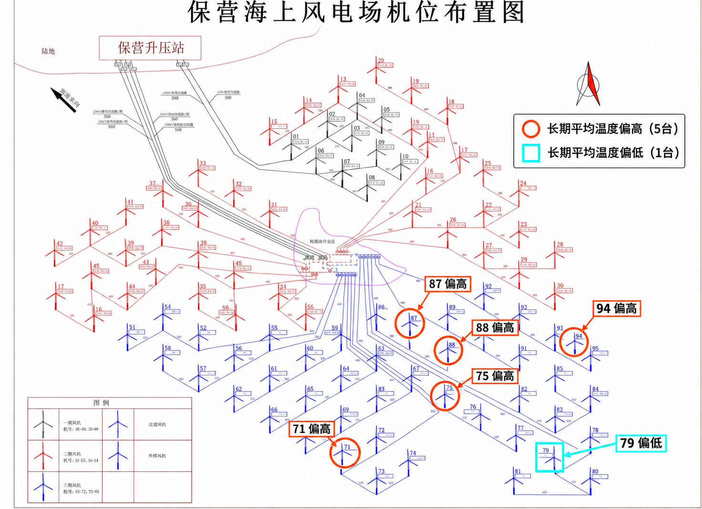

# 会议总结（2026-11-24）

## 本周进度

### 内容一：上周内容修改

- **中位线与极差带图范围修改**：<iframe src="middle1.html" width="100%" height="620" style="border:1px solid #e0e0e0;"></iframe>
[在新窗口打开交互图](middle1.html)

- **85台风机均值分布的雨云图**：


- **将偏高或偏低的风机在图中标注**：


### 内容二：数据预处理

- **导出中位数数据**：代码如下

```python
import pandas as pd
from pathlib import Path

# ==============================
# 1. 文件路径
# ==============================

folder = Path(r"D:\桌面\一二三期数据")

humidity_file = folder / "二三期机舱湿度_mean.csv"
temperature_file = folder / "二三期外界温度_mean.csv"

# ==============================
# 2. 计算每一时刻的中位数
# ==============================

def calculate_median(input_file, output_file, column_name):

    print(f"\n正在处理：{input_file.name}")

    # 尝试不同编码
    try:
        df = pd.read_csv(input_file, encoding="utf-8-sig")
    except UnicodeDecodeError:
        df = pd.read_csv(input_file, encoding="gb18030")

    # 第一列为时间，其余列为风机数据
    time_col = df.columns[0]
    turbine_cols = df.columns[1:]

    # 转换风机数据为数值类型
    df[turbine_cols] = df[turbine_cols].apply(
        pd.to_numeric, errors="coerce"
    )

    # 计算每一时刻的中位数
    median_values = df[turbine_cols].median(
        axis=1, skipna=True
    )

    # 统计每一时刻有效风机数量
    valid_counts = df[turbine_cols].count(axis=1)

    # 输出结果
    result = pd.DataFrame({
        "时间": df[time_col],
        column_name: median_values,
        "有效风机数量": valid_counts
    })

    # 保存CSV
    result.to_csv(
        output_file,
        index=False,
        encoding="utf-8-sig"
    )

    print(f"总时间点数：{len(result)}")
    print(f"风机数量：{len(turbine_cols)}")
    print(f"全部缺失的时间点：{(valid_counts == 0).sum()}")
    print(f"有效风机不足85台的时间点：{(valid_counts < 85).sum()}")
    print(f"保存成功：{output_file}")

    print("\n前5行数据：")
    print(result.head())

    return result


# ==============================
# 3. 计算湿度中位数
# ==============================

humidity_median = calculate_median(
    input_file=humidity_file,
    output_file=folder / "二三期机舱湿度_中位数.csv",
    column_name="机舱湿度中位数"
)

# ==============================
# 4. 计算温度中位数
# ==============================

temperature_median = calculate_median(
    input_file=temperature_file,
    output_file=folder / "二三期外界温度_中位数.csv",
    column_name="外界温度中位数"
)

print("\n全部处理完成！")
```
完整数据见 → [temperature.csv](./data/table.csv) 
         
          → [humidity.csv](./data/table.csv) 

- **数据集划分结果如下**：

| 数据集 | 时间范围 |
|---|---|
| 训练集 | 2023.01—2024.12 | 
| 验证集 | 2025.01—2025.07 | 
| 测试集 | 2025.08—2026.05 | 

- **数据缺失情况**：

| 数据集 | 时间点数 | 缺失比例 |
|---|---|---|
| 训练集 | 105264 | 2.75% |
| 验证集 | 30528 | 0% |
| 测试集 | 39313 | 8.32% |

### 内容三：初步建模调参

初始模型采用单层网络、32维隐藏层和0.001学习率。

- **初步建模结果**：

| 预测任务 | MAE | MSE | RMSE | R² |
|---|---:|---:|---:|---:|
| 温度RNN | 0.4151 | 0.4691 | 0.6849 | 0.9870 |
| 温度LSTM | 0.4142 | 0.4659 | 0.6826 | 0.9871 |
| 湿度RNN | 1.1718 | 2.8727 | 1.6949 | 0.9403 |
| 湿度LSTM | 1.1650 | 2.8197 | 1.6792 | 0.9414 |

- **本次调节的参数数据如下**：

| 参数 | 测试范围 |
|---|---|
| 隐藏层维度 | 32、64、128 |
| 网络层数 | 1、2 |
| 学习率 | 0.001、0.0005 |
| 最大训练轮数 | 30 |

以验证集RMSE最小作为最优参数选择标准。

- **最终选择的参数如下**：

| 预测任务 | 隐藏维度 | 层数 | 学习率 |
|---|---:|---:|---:|
| 温度RNN | 32 | 1 | 0.001 |
| 温度LSTM | 128 | 1 | 0.001 |
| 湿度RNN | 64 | 1 | 0.0005 |
| 湿度LSTM | 128 | 1 | 0.001 |

- **模型预测结果**：

| 预测任务 | MAE | RMSE | R² |
|---|---:|---:|---:|
| 温度RNN | 0.4151 | 0.6849 | 0.9870 |
| 温度LSTM | 0.4038 | 0.6599 | 0.9880 |
| 湿度RNN | 1.1671 | 1.6914 | 0.9405 |
| 湿度LSTM | 1.1548 | 1.6764 | 0.9416 |

（温度误差单位为℃，湿度误差单位为相对湿度百分点）

### 内容四：下一阶段计划

- **任务一**： 比较6小时、12小时和24小时历史输入长度对预测效果的影响。
- **任务二**： 引入Prophet、TimesFM等模型开展对比实验。


