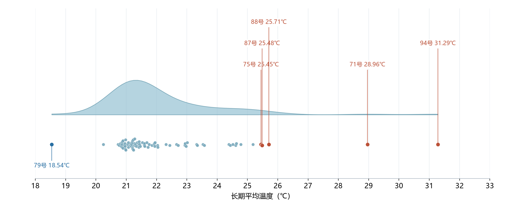

# 会议总结（2026-11-24）

## 本周进度

### 内容一：上周内容修改

- **中位线与极差带图范围修改**：<iframe src="middle1.html" width="100%" height="620" style="border:1px solid #e0e0e0;"></iframe>
[在新窗口打开交互图](middle1.html)

- **85台风机均值分布的雨云图**：

  

